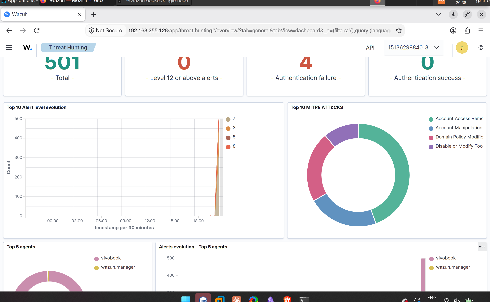
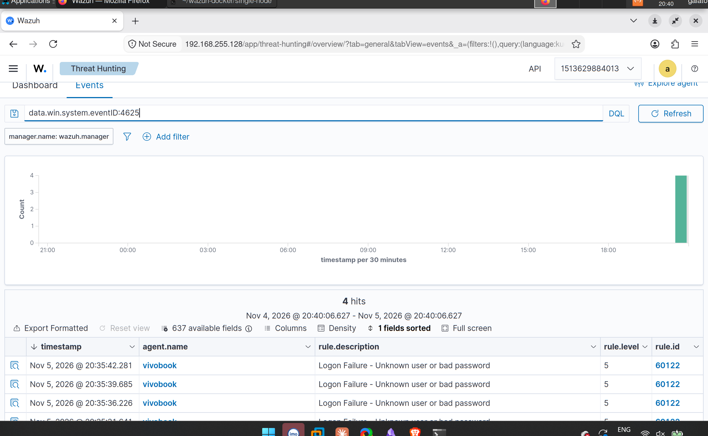
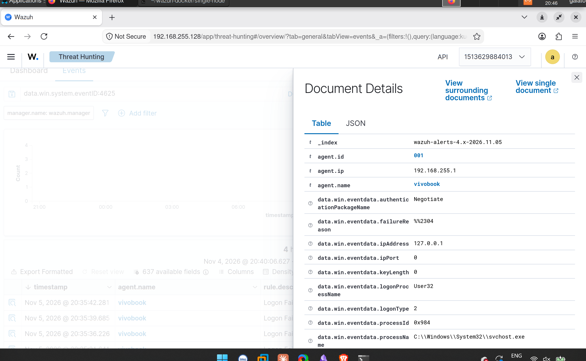
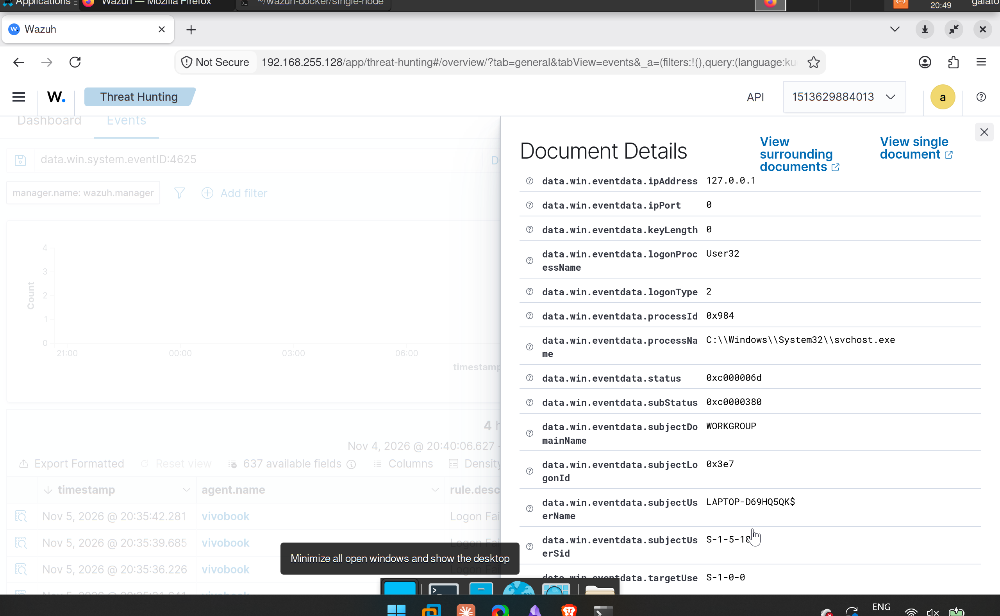

# My first detection: catching failed Windows logons in Wazuh

*SOC lab journal · 5 Nov 2026 · Detection #0 (local test)*

## TL;DR

I installed a Wazuh agent on my Windows laptop, locked the screen and typed wrong credentials on purpose. My Wazuh SIEM caught them as **Event ID 4625** (rule 60122, "Logon Failure – Unknown user or bad password"). Then I read the event field by field, and worked out what would look different if it were a real attacker brute-forcing RDP from the internet.

Full journal entry: [soc-lab-journal / 2026-11-05](https://github.com/salmansainudeen/soc-lab-journal/blob/master/journal/2026-11-05.md)

## The setup

- **SIEM:** Wazuh (manager, indexer, dashboard), single-node Docker compose on an Arch Linux VM in VMware
- **Endpoint:** my Windows laptop with the Wazuh agent (`vivobook`), sending the Security event log
- **Test:** lock screen (Win + L) → wrong credentials several times → log in properly

## What Wazuh caught

Searching `data.win.system.eventID:4625` gave **4 hits**, a few seconds apart, all level 5:

## Reading one event

| Field | Value | What it tells me |
|---|---|---|
| `eventID` | 4625 | A logon failed |
| `logonType` | 2 | Interactive: someone at the keyboard |
| `ipAddress` | 127.0.0.1 | The machine itself, not a remote host |
| `logonProcessName` | User32 | The Windows sign-in screen |
| `status` | 0xc000006d | Logon failed (general) |
| `subStatus` | 0xc0000380 | The specific reason. Looks like a wrong Windows Hello PIN; still verifying |
| `targetUserSid` | S-1-0-0 | Null SID: Windows didn't tie the attempt to an account |

## What broke

I made 8 attempts but only 4 were logged. My best explanation so far: I was at the **PIN** screen, which doesn't log every failure the way a password prompt does. Next test uses a password.

## My test vs a real attack

| | My test | RDP brute force from the internet |
|---|---|---|
| `logonType` | 2 (keyboard) | **10** (RDP) |
| `ipAddress` | 127.0.0.1 | The **attacker's public IP** |
| Pattern | 4 failures | Many failures fast, then maybe one **4624** |

The failures aren't the emergency. The single **4624** (successful logon) after a run of 4625s is: it means the password was guessed and the attacker is inside. First response: disable the account, block the source IP, then check what happened after the logon (new processes, 4688; other machines touched).

## Next

Windows VM in the lab → a real brute force over RDP with Hydra → make Wazuh's multiple-failures rule fire → write the detection.

[← Write-ups](writeups.html) · [Home](./)
